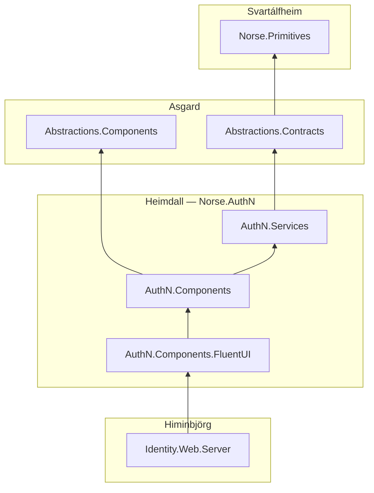

# Heimdall

> Heimdall — the watchman who decides who crosses Bifröst.

<p align="center">
  
</p>

*Image credit: [@norsemythologyclips](https://www.instagram.com/norsemythologyclips/) — go follow them.*

The authn story for the Norse Architecture — **`Norse.AuthN`**: login, register, two-factor, recovery, passkeys, account management, and personal-data disclosure, enforced identically across Blazor Server, WASM, and MAUI, with the backing gRPC contracts. Heimdall rides on nothing above [Asgard](https://github.com/NorseArchitecture/Asgard); [Himinbjörg](https://github.com/NorseArchitecture/Himinbjorg) rides on *it* — implementing the contracts and hosting the pages — so the gate and the hall that stands behind it depend on each other by design.

## What stands at the gate

| Project | What it is |
|---|---|
| [`Norse.AuthN.Services`](src/AuthN.Services) | The wire tier, deliberately thin: [`IAuthenticationService`](src/AuthN.Services/IAuthenticationService.cs) (Login / Register / EmailExists / Logout, plus the account-lifecycle operations TwoFactorSignIn / RecoveryCodeSignIn / ForgotPassword / ResetPassword / ConfirmEmail / ConfirmEmailChange / ResendEmailConfirmation), [`IIdentityService`](src/AuthN.Services/IIdentityService.cs) (self-disclosure and masked disclosure), and [`IAccountService`](src/AuthN.Services/IAccountService.cs) (self-service account management: GetAccountStatus / SetPhoneNumber / ChangePassword / SetPassword / ChangeEmail / GetExternalLogins / RemoveExternalLogin / DeletePersonalData), and three more for two-factor and passkeys: [`ITwoFactorService`](src/AuthN.Services/ITwoFactorService.cs) (GetAuthenticatorSetup / EnableAuthenticator / RevealRecoveryCodes / ResetAuthenticator / DisableTwoFactor / GenerateRecoveryCodes / ForgetTwoFactorClient) and [`IPasskeyService`](src/AuthN.Services/IPasskeyService.cs) (GetPasskeys / GetPasskey / GetPasskeyCreationOptions / AddPasskey / RenamePasskey / RemovePasskey), both under the `Account` policy, and [`ISignInMethodsService`](src/AuthN.Services/ISignInMethodsService.cs) (GetSignInMethods / GetPasskeyRequestOptions / PasskeySignIn) under the `Public` policy, their pure `[DataContract]` wire records (the account ones: [`AccountStatusResponse`](src/AuthN.Services/AccountStatusResponse.cs), [`SetPhoneNumberRequest`](src/AuthN.Services/SetPhoneNumberRequest.cs) — whose `Phone` stamp is a nullable `Result<PhoneNumber>?`, null meaning clear — [`ChangePasswordRequest`](src/AuthN.Services/ChangePasswordRequest.cs), [`SetPasswordRequest`](src/AuthN.Services/SetPasswordRequest.cs), [`ChangeEmailRequest`](src/AuthN.Services/ChangeEmailRequest.cs), [`ExternalLoginsResponse`](src/AuthN.Services/ExternalLoginsResponse.cs) with its [`ExternalLoginEntry`](src/AuthN.Services/ExternalLoginEntry.cs)/[`ExternalProviderEntry`](src/AuthN.Services/ExternalProviderEntry.cs), [`RemoveExternalLoginRequest`](src/AuthN.Services/RemoveExternalLoginRequest.cs), [`DeletePersonalDataRequest`](src/AuthN.Services/DeletePersonalDataRequest.cs); the two-factor and passkey ones: [`AuthenticatorSetupResponse`](src/AuthN.Services/AuthenticatorSetupResponse.cs), [`EnableAuthenticatorRequest`](src/AuthN.Services/EnableAuthenticatorRequest.cs), [`RevealRecoveryCodesRequest`](src/AuthN.Services/RevealRecoveryCodesRequest.cs)/[`RecoveryCodesResponse`](src/AuthN.Services/RecoveryCodesResponse.cs), [`PasskeysResponse`](src/AuthN.Services/PasskeysResponse.cs)/[`PasskeyEntry`](src/AuthN.Services/PasskeyEntry.cs), [`GetPasskeyRequest`](src/AuthN.Services/GetPasskeyRequest.cs), [`PasskeyCreationOptionsResponse`](src/AuthN.Services/PasskeyCreationOptionsResponse.cs), [`AddPasskeyRequest`](src/AuthN.Services/AddPasskeyRequest.cs), [`RenamePasskeyRequest`](src/AuthN.Services/RenamePasskeyRequest.cs), [`RemovePasskeyRequest`](src/AuthN.Services/RemovePasskeyRequest.cs), [`GetSignInMethodsRequest`](src/AuthN.Services/GetSignInMethodsRequest.cs)/[`SignInMethodsResponse`](src/AuthN.Services/SignInMethodsResponse.cs)/[`ExternalProviderLink`](src/AuthN.Services/ExternalProviderLink.cs), [`PasskeyRequestOptionsResponse`](src/AuthN.Services/PasskeyRequestOptionsResponse.cs), [`PasskeySignInRequest`](src/AuthN.Services/PasskeySignInRequest.cs); [`LoginRequest`](src/AuthN.Services/LoginRequest.cs) carries the gate's return URL), and the policies ([`AuthNPolicies`](src/AuthN.Services/AuthNPolicies.cs), [`IdentityPolicies`](src/AuthN.Services/IdentityPolicies.cs)): each name with its `[NorsePolicy]` configure method, which the host's generated registration composes — `Public`, `Account` and `MaskedDisclosure` admit only the browser's cookie, while `AccountRead` and `Self` (reading your own account and personal data) also admit a user bearer token pinned to the `Norse.User` audience. The issuance surface carries no result record of its own — every `IAuthenticationService` operation returns Asgard's `Outcome<NavigationResult>` or `Outcome<BoolResponse>` — while the disclosure surface answers with its own `PersonalDataResponse`/`MaskedPersonalDataResponse` the account surface reads state through `AccountStatusResponse`/`ExternalLoginsResponse`, and the two-factor, passkey and sign-in-method surfaces answer with their own payloads (setup, recovery codes, passkey lists, WebAuthn options, sign-in links). No Razor, no validation library, no mediator coupling — a consumer building their own UI references this assembly and nothing else |
| [`Norse.AuthN.Components`](src/AuthN.Components) | The headless tier: pages with no visual framework ([Logout](src/AuthN.Components/Logout.razor), [Lockout](src/AuthN.Components/Pages/Lockout.razor), [AccessDenied](src/AuthN.Components/Pages/AccessDenied.razor), the confirmation pages), the FluentValidation validators ([login](src/AuthN.Components/LoginRequestValidator.cs), [register](src/AuthN.Components/RegisterRequestValidator.cs), [masked disclosure](src/AuthN.Components/GetMaskedPersonalDataRequestValidator.cs), and the seven account-lifecycle validators: [two-factor](src/AuthN.Components/TwoFactorSignInRequestValidator.cs), [recovery code](src/AuthN.Components/RecoveryCodeSignInRequestValidator.cs), [forgot password](src/AuthN.Components/ForgotPasswordRequestValidator.cs), [reset password](src/AuthN.Components/ResetPasswordRequestValidator.cs), [confirm email](src/AuthN.Components/ConfirmEmailRequestValidator.cs), [confirm email change](src/AuthN.Components/ConfirmEmailChangeRequestValidator.cs), [resend confirmation](src/AuthN.Components/ResendEmailConfirmationRequestValidator.cs), and the six account validators: [set phone number](src/AuthN.Components/SetPhoneNumberRequestValidator.cs), [change password](src/AuthN.Components/ChangePasswordRequestValidator.cs), [set password](src/AuthN.Components/SetPasswordRequestValidator.cs), [change email](src/AuthN.Components/ChangeEmailRequestValidator.cs), [remove external login](src/AuthN.Components/RemoveExternalLoginRequestValidator.cs), [delete personal data](src/AuthN.Components/DeletePersonalDataRequestValidator.cs), and the seven two-factor and passkey validators: [enable authenticator](src/AuthN.Components/EnableAuthenticatorRequestValidator.cs), [reveal recovery codes](src/AuthN.Components/RevealRecoveryCodesRequestValidator.cs), [get passkey](src/AuthN.Components/GetPasskeyRequestValidator.cs), [add passkey](src/AuthN.Components/AddPasskeyRequestValidator.cs), [rename passkey](src/AuthN.Components/RenamePasskeyRequestValidator.cs), [remove passkey](src/AuthN.Components/RemovePasskeyRequestValidator.cs), [passkey sign-in](src/AuthN.Components/PasskeySignInRequestValidator.cs)), [`NotAuthorizedRedirect`](src/AuthN.Components/NotAuthorizedRedirect.razor) (the router's not-authorized template: a signed-in account that fails a policy lands on AccessDenied, carrying its return URL; anyone else, the anonymous principal included, is sent to sign in), [`ManageStatus`](src/AuthN.Components/Shared/ManageStatus.cs) (the account-management redirect's `status` keys and the text each selects — the key crosses the query string, the text never does), and the session-transition seam (the form base `OutcomeFormComponentBase` and the `ServerValidation` machinery that projects server-side failures into the form's own validation display moved to Asgard's `Abstractions.Components` on 2026-08-09) ([`ISessionTransition`](src/AuthN.Components/ISessionTransition.cs)/[`ForceLoadSessionTransition`](src/AuthN.Components/ForceLoadSessionTransition.cs)) — only the gate performs a forced document load for a sign-in change |
| [`Norse.AuthN.Components.FluentUI`](src/AuthN.Components.FluentUI) | The visual skin: [`GateLayout`](src/AuthN.Components.FluentUI/GateLayout.razor), [Login](src/AuthN.Components.FluentUI/Login.razor) and [LoginWithPasskey](src/AuthN.Components.FluentUI/LoginWithPasskey.razor) (click-to-sign-in over the browser's assertion ceremony), both carrying the `returnUrl` they were reached with to the server and linked to each other and to every external provider by [`SignInMethodLinks`](src/AuthN.Components.FluentUI/SignInMethodLinks.razor), whose every link is a server-built URL from `GetSignInMethods`, [Register](src/AuthN.Components.FluentUI/Register.razor), [`ModelValidationSummary`](src/AuthN.Components.FluentUI/ModelValidationSummary.razor), [recovery codes](src/AuthN.Components.FluentUI/Shared/ShowRecoveryCodes.razor), and the account-lifecycle pages — [ForgotPassword](src/AuthN.Components.FluentUI/ForgotPassword.razor), [ResendEmailConfirmation](src/AuthN.Components.FluentUI/ResendEmailConfirmation.razor), and five routable shims over plain-parameter units the story catalog renders directly: [LoginWith2fa](src/AuthN.Components.FluentUI/LoginWith2fa.razor) → [`TwoFactorForm`](src/AuthN.Components.FluentUI/TwoFactorForm.razor), [LoginWithRecoveryCode](src/AuthN.Components.FluentUI/LoginWithRecoveryCode.razor) → [`RecoveryCodeForm`](src/AuthN.Components.FluentUI/RecoveryCodeForm.razor), [ResetPassword](src/AuthN.Components.FluentUI/ResetPassword.razor) → [`ResetPasswordForm`](src/AuthN.Components.FluentUI/ResetPasswordForm.razor), [ConfirmEmail](src/AuthN.Components.FluentUI/ConfirmEmail.razor) → [`ConfirmEmailPanel`](src/AuthN.Components.FluentUI/ConfirmEmailPanel.razor), and [ConfirmEmailChange](src/AuthN.Components.FluentUI/ConfirmEmailChange.razor) → [`ConfirmEmailChangePanel`](src/AuthN.Components.FluentUI/ConfirmEmailChangePanel.razor). The two confirm panels are click-to-confirm: an emailed token is consumed on a click, never on load. The account-management tree sits beside them: [`ManageLayout`](src/AuthN.Components.FluentUI/ManageLayout.razor) and [`ManageNavMenu`](src/AuthN.Components.FluentUI/ManageNavMenu.razor) (a `FluentNav`/`FluentNavItem` menu) at the project root, and under [`Manage/`](src/AuthN.Components.FluentUI/Manage) the loader-over-form pages — [Index](src/AuthN.Components.FluentUI/Manage/Index.razor) → [`ProfileForm`](src/AuthN.Components.FluentUI/Manage/ProfileForm.razor), [Email](src/AuthN.Components.FluentUI/Manage/Email.razor) → [`ChangeEmailForm`](src/AuthN.Components.FluentUI/Manage/ChangeEmailForm.razor), [ChangePassword](src/AuthN.Components.FluentUI/Manage/ChangePassword.razor) and [SetPassword](src/AuthN.Components.FluentUI/Manage/SetPassword.razor) → the shared [`PasswordPanel`](src/AuthN.Components.FluentUI/Manage/PasswordPanel.razor) ([`ChangePasswordForm`](src/AuthN.Components.FluentUI/Manage/ChangePasswordForm.razor) or [`SetPasswordForm`](src/AuthN.Components.FluentUI/Manage/SetPasswordForm.razor), chosen by whether a password exists, with the title and heading following the chosen form; neither route redirects to the other), [DeletePersonalData](src/AuthN.Components.FluentUI/Manage/DeletePersonalData.razor) → [`DeletePersonalDataForm`](src/AuthN.Components.FluentUI/Manage/DeletePersonalDataForm.razor) — plus [ExternalLogins](src/AuthN.Components.FluentUI/Manage/ExternalLogins.razor) (its add-provider links target a server HTTP endpoint, not a routed page, so they set FluentLink's `ForceLoad`) and the moved [PersonalData](src/AuthN.Components.FluentUI/Manage/PersonalData.razor), and the two-factor and passkey pages: [TwoFactorAuthentication](src/AuthN.Components.FluentUI/Manage/TwoFactorAuthentication.razor), [EnableAuthenticator](src/AuthN.Components.FluentUI/Manage/EnableAuthenticator.razor) → [`VerifyAuthenticatorForm`](src/AuthN.Components.FluentUI/Manage/VerifyAuthenticatorForm.razor), [RecoveryCodesHandoff](src/AuthN.Components.FluentUI/Manage/RecoveryCodesHandoff.razor) (routed at `/Account/Manage/ShowRecoveryCodes`), the click-to-confirm [ResetAuthenticator](src/AuthN.Components.FluentUI/Manage/ResetAuthenticator.razor), [Disable2fa](src/AuthN.Components.FluentUI/Manage/Disable2fa.razor) and [GenerateRecoveryCodes](src/AuthN.Components.FluentUI/Manage/GenerateRecoveryCodes.razor), [Passkeys](src/AuthN.Components.FluentUI/Manage/Passkeys.razor), and [RenamePasskey](src/AuthN.Components.FluentUI/Manage/RenamePasskey.razor) → [`RenamePasskeyForm`](src/AuthN.Components.FluentUI/Manage/RenamePasskeyForm.razor). Both passkey ceremonies run through [`wwwroot/passkeys.js`](src/AuthN.Components.FluentUI/wwwroot/passkeys.js), reached only through the one internal wrapper both passkey pages share; the script never fetches — the page hands it the server's options. [`Manage/_Imports.razor`](src/AuthN.Components.FluentUI/Manage/_Imports.razor) stamps every one of them with `@layout ManageLayout` and the `Account` authorization policy, and `ManagePolicyLockTests` fails the build's tests if a routed Manage page ever loses either. A different design system lands as a sibling package, not an edit |

## The dependency graph

Arrows point at the thing depended on. Himinbjörg rides *above* the gate — implementing its contracts and hosting its pages — which is why Heimdall isn't unambiguously topmost in the chain.



Dependencies are transitive-first by house law — `Norse.Primitives` reaches the wire records through `Abstractions.Contracts`, so no direct edge exists; versions are managed in one place, and the hosting composition root (Yggdrasil) pins the entire closure explicitly for deterministic builds and a single place to fix a vulnerable package. The one sanctioned break rides in `AuthN.Services.csproj` today: a direct floated `System.Security.Cryptography.Xml` overriding the known-vulnerable transitive version hosted by `System.ServiceModel.Primitives`.

## How the gate works

The components never know what transport they're standing on. They inject the contract (`IAuthenticationService`), consume `Task<Outcome<T>>`, and pattern-match the result — success navigates, failure renders through the same validation display as client-side errors. Which implementation stands behind the contract is a per-host DI decision: Himinbjörg registers the real thing for Blazor Server, Yggdrasil wires the generated gRPC-Web client for WASM, and [Bragi](https://github.com/NorseArchitecture/Bragi)'s story catalog registers a scripted fake. One component, three worlds, zero `#if`.

The requests are wire-stamped: the serialized email member is `Result<EmailAddress>` — the parse verdict itself rides the wire — while the form binds a raw buffer (`EmailInput`) that is never serialized and re-stamps the verdict on every assignment, so no code path sets the text without refreshing the parse. Deserialization is the parse event: the server holds its own verdict regardless of what the client claimed. Validators register their rules on the stamp, not the string — the parser owns format truth, the validator owns business truth — and the register flow chains an async email-existence lookup behind the shape gate, so unproven input never buys a round trip. Design: Glitnir's [wire-stamped request scalars spec](https://github.com/NorseArchitecture/Glitnir/blob/master/docs/Platform/specs/2026-08-08-wire-stamped-request-scalars-design.md).

Validation is declared once and enforced twice: the same validator class runs client-side (Blazilla, against the wire record directly) and server-side (through Himinbjörg's generated adapter) — one declaration, never duplicated, so the two tiers cannot drift. And the wire records themselves are kept deliberately dumb: no authorization attributes, no mediator markers — a rejected login comes back as a typed failure (`Failed(Problem)`), never as a success record with a false flag. Success is Asgard's `NavigationResult`: a single server-resolved `NextUrl` the client navigates unconditionally (return URL, 2FA challenge, lockout — only the server knows the map). The issuance surface carries no result record of its own — every response record on the wire tier (disclosure, account state, two-factor setup and recovery codes, passkey lists, WebAuthn options, sign-in links) is a domain payload rather than a next hop.

The server authors every flow URL: each continuation, status key, id, token, return URL and redirect. The sign-in pages carry the `returnUrl` they were reached with to the server and never navigate to it; the links between them and to each external provider come back from `GetSignInMethods` with the return URL already carried, and the client renders them verbatim. Only the server decides where a sign-in lands. Three older links are still composed in the browser — the login redirect's return URL, the Manage page's link-a-provider start, and the two-factor page's recovery-code link — and the server validates each one.

Nothing on a page acts before Blazor boots. Every form's submit binds `Disabled="!CanSubmit"` and every click trigger on Asgard's `OutcomeComponentBase` binds `Disabled="!CanAct"` (interactive and not dispatching — loaders are not gated, so a statically rendered page still arrives with its data); `FormStaticRenderLockTests` and `ClickStaticRenderLockTests` lock both. The one click trigger off that base, the change-email page's resend button, keeps its own in-flight guard. A trigger that needs the browser — adding a passkey, signing in with one — also stays disabled until browser support is known, and is hidden only once support is known to be missing.

## Build and test

```shell
dotnet build Heimdall.slnx   # warnings are errors — a single warning fails
dotnet test Heimdall.slnx    # xUnit v3 + Shouldly on Microsoft.Testing.Platform
```

Requires the .NET 11 preview SDK pinned by `global.json`. The realm builds standalone — it is its own clone target, not only a Bifröst submodule. `RequestContractTests` is the wire tier's purity lock: no `[Authorize]` on wire records, no mediator-law assembly reference, a trailing `CancellationToken` on every service method, and `[OperationContract]` on every operation of all six contracts — a code-first gRPC method without it is a silently dead endpoint.

## Status

The injection-clean pages live here; pages still coupled to server types (`UserManager`, `HttpContext`) remain in Himinbjörg's `Identity.Web.Server` and migrate over as they come clean — placement is a rule, not a list. Pages keep the ASP.NET Identity scaffold's `/Account/*` routes deliberately; renaming is a separate, deferred curation pass. Design for anything new happens first in [Glitnir](https://github.com/NorseArchitecture/Glitnir)'s [docs/Heimdall/](https://github.com/NorseArchitecture/Glitnir/tree/master/docs/Heimdall) — brainstorm → spec → plan, before any code.

## The cosmos

Heimdall is one realm of the [Norse Architecture](https://github.com/NorseArchitecture). The whole platform composes at [Bifröst](https://github.com/NorseArchitecture/Bifrost) — clone once, cross the bridge. Every design is tried in [Glitnir](https://github.com/NorseArchitecture/Glitnir), the design court, before code is forged here.

## Soundtrack: Gjallarhorn
[](https://www.youtube.com/watch?v=-Y0OKTuMICM)
